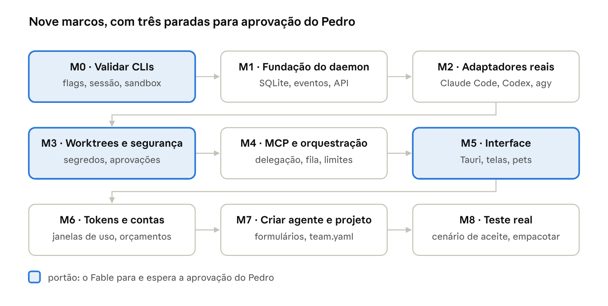

# Regente — Plano de construção do MVP (para o Fable)

14/11/2026 · Pedro

## Como usar este plano

Você (Fable) vai construir o MVP do **Regente**, um orquestrador local de agentes de código (Claude Code, Codex e Antigravity CLI) com uma interface para monitorar o que cada agente faz e quanto gasta. Execute os marcos **em ordem**, um de cada vez, e pare nos portões de aprovação.

1. Leia o plano inteiro antes de escrever código.
2. Para cada marco: implemente as tarefas, rode a verificação, faça commits pequenos e escreva um relatório curto em `docs/progresso.md` (o que foi feito, o que ficou, decisões tomadas).
3. **Portões**: os marcos M0, M3 e M5 terminam com uma parada obrigatória. Mostre o resultado ao Pedro e só siga depois da aprovação dele.
4. Se algo neste plano estiver errado (uma flag de CLI que não existe, uma biblioteca abandonada), não contorne em silêncio: registre em `docs/decisoes.md` o que encontrou, o que escolheu e por quê.
5. Na dúvida entre duas formas de fazer, escolha a mais simples que passe nos critérios de aceite.

Documentos de referência (o Pedro pode exportar e colocar em `docs/`): o canvas de design da interface e o system design do Regente. Este plano já resume o que é preciso deles.

## Objetivo e escopo do MVP

O MVP está pronto quando o Pedro consegue dar uma tarefa a um orquestrador e ver, sem abrir terminal nenhum, três agentes em CLIs diferentes trabalhando, conversando entre si e gastando dentro de um orçamento.

| Entra no MVP | Fica para depois (v0.2+) |
| --- | --- |
| Daemon local em Rust com SQLite e API REST + WebSocket | Acesso remoto (Tailscale, celular, PWA) |
| Adaptadores para Claude Code, Codex e Antigravity CLI (`agy`) | Tela de Plugins (instalar MCPs pela UI) |
| MCP mensageiro: mensagens e delegação entre agentes | Tela de Skills e busca em lojas e GitHub |
| Worktree por agente e por tarefa | Líderes de equipe (hierarquia com mais de 1 nível) |
| Segurança base: ambiente limpo, negação de leitura de segredos, varredura de vazamento, aprovações | Mapa do projeto em cache e grafo do sistema |
| Orçamentos, uso por conta (5h, dia, semana) e pausa automática | Roteamento automático entre provedores |
| App Tauri: barra lateral, visão geral, tela do agente, contas e perfis | Salão pixel art |
| Criar agente e criar projeto (formulários do canvas) | Notificações push |

Um só usuário, uma só máquina (macOS e Linux). Windows não é alvo do MVP.

## Stack e estrutura do repositório

Um monorepo com um workspace Cargo (daemon e app Tauri) e a interface em React. Confirme no M0 que cada biblioteca está ativa e na versão estável atual antes de fixar.

| Camada | Escolha | Observação |
| --- | --- | --- |
| Runtime assíncrono | tokio | Base de tudo no daemon |
| HTTP + WebSocket | axum | REST para comandos, WS para eventos |
| Banco | SQLite em modo WAL (rusqlite ou sqlx) | Migrações numeradas em `daemon/migrations/` |
| Processos | tokio::process; portable-pty só para o terminal sob demanda | Modo headless primeiro |
| MCP | SDK oficial de MCP em Rust (rmcp) | Servidor HTTP local do mensageiro |
| Observar arquivos | notify | Varredura de segredos nos worktrees |
| Serialização e logs | serde, serde_json, tracing | Logs estruturados em JSON |
| App desktop | Tauri 2 | Só casca: fala com o daemon pela API |
| Interface | React + TypeScript + Vite, Zustand para estado | Telas do canvas de design |
| Testes | cargo test, Vitest, Playwright para a UI | CLIs falsos para testes (ver M1) |

```text
regente/
├── Cargo.toml              # workspace
├── daemon/                 # binário regented
│   ├── src/
│   │   ├── main.rs
│   │   ├── api/            # rotas REST e WebSocket
│   │   ├── store/          # SQLite, migrações, consultas
│   │   ├── adapters/       # claude.rs, codex.rs, agy.rs, fake.rs
│   │   ├── orchestrator/   # fila, tarefas, orçamentos
│   │   ├── mcp/            # servidor do mensageiro
│   │   ├── security/       # ambiente limpo, varredura, aprovações
│   │   └── worktree/       # ciclo de vida dos worktrees
│   ├── migrations/
│   └── tests/
├── app/                    # Tauri
│   └── src-tauri/
├── ui/                     # React + Vite
│   └── src/
│       ├── screens/        # Overview, Agent, Profiles, NewAgent, NewProject
│       ├── components/     # Sidebar, AgentCard, Pet, UsageBars, Timeline
│       └── api/            # cliente REST + WS tipado
├── shared/
│   └── schema/             # JSON Schema dos eventos e da API
├── fixtures/               # saídas gravadas dos CLIs
└── docs/                   # progresso.md, decisoes.md, referências
```

Código, nomes de arquivos e comentários em inglês; textos da interface em português do Brasil.

## Regras para o agente

### Segurança (não negociável)

- Nunca leia, imprima ou copie o conteúdo de `.env*`, `secrets/`, `*.pem` ou chaves SSH, nem nos testes. Use valores falsos em `fixtures/`.
- Nunca rode `git push`, não publique pacotes e não faça chamadas pagas às APIs dos provedores sem pedir ao Pedro. Testes automáticos usam o adaptador falso.
- Quando um marco precisar dos CLIs reais (M0 e M8), peça ao Pedro para rodar ou autorizar e use tarefas pequenas e baratas.
- Nenhuma dependência nova fora da tabela da stack sem registrar o motivo em `docs/decisoes.md`.

### Qualidade

- Cada módulo do daemon com testes de unidade; cada rota da API com teste de integração.
- `cargo clippy -- -D warnings`, `cargo fmt --check`, `pnpm lint` e `pnpm test` limpos antes de fechar um marco.
- Commits pequenos, no formato `tipo(escopo): descrição` (ex.: `feat(adapters): parse codex json events`).
- Erros tratados com tipos (thiserror no daemon), nunca `unwrap()` fora de testes.

### Desempenho da interface (motivo principal do projeto)

- A UI nunca renderiza terminal por padrão: só eventos. O terminal (xterm.js) é criado ao clicar em "Abrir terminal" e destruído ao fechar.
- Atualizações da UI agrupadas a cada 250 ms por agente.
- Animações dos pets em CSS, pausadas fora da tela e com a janela sem foco; respeitar `prefers-reduced-motion`.
- Meta: com 4 agentes ativos, o app parado em segundo plano abaixo de 2% de CPU e sem uso contínuo de GPU (medir no M5).

## Contratos centrais

Defina estes contratos em `shared/schema/` no M1 e gere os tipos TypeScript a partir deles. Tudo o que a UI mostra sai de um evento.

### Evento normalizado

```json
{
  "id": "evt_01J...",
  "ts": "2026-11-14T18:13:02Z",
  "agent_id": "ag_backend",
  "task_id": "tk_sensores",
  "kind": "file_edit",
  "target": "src/api/sensores.ts",
  "summary": "Adicionou from/to na rota",
  "lines_added": 46,
  "lines_removed": 12,
  "usage": { "tokens_in": 1200, "tokens_out": 340, "tokens_cache": 900, "cost_usd": 0.012, "cost_source": "estimated" },
  "raw_ref": "raw/ag_backend/000123.jsonl"
}
```

Valores de `kind`: `status` (trabalhando, pensando, aguardando, ocioso), `thinking`, `file_read`, `file_edit`, `command`, `command_result`, `message_sent`, `message_received`, `task_assigned`, `task_done`, `approval_requested`, `approval_decided`, `security_alert`, `error`. O `cost_source` é `reported` quando o CLI informa o custo e `estimated` quando calculamos pelos tokens.

### API REST (prefixo `/api/v1`)

| Método e rota | Faz |
| --- | --- |
| `GET /projects`, `POST /projects` | Listar e criar projetos |
| `GET /agents?project=`, `POST /agents`, `PATCH /agents/{id}` | Listar, criar e editar agentes |
| `POST /tasks` | Nova tarefa para o orquestrador de um projeto |
| `POST /agents/{id}/pause`, `/resume`, `/message` | Controlar um agente e mandar instrução |
| `GET /agents/{id}/timeline?before=` | Linha do tempo paginada |
| `GET /agents/{id}/diff/latest` | Última alteração com diff |
| `GET /usage?window=5h\|day\|week` | Uso por conta e por agente |
| `GET /accounts`, `PATCH /accounts/{id}` | Contas e regras de limite |
| `GET /approvals?status=pending`, `POST /approvals/{id}` | Ver e decidir aprovações |
| `GET /snapshot` | Estado completo para quem acabou de conectar |

### WebSocket (`/api/v1/stream`)

- Ao conectar, o cliente recebe `{"type":"snapshot", ...}` e depois só `{"type":"events","items":[...]}` agrupados a cada 250 ms.
- `{"type":"usage", ...}` a cada mudança de uso; `{"type":"approval", ...}` quando um agente pede aprovação.
- O terminal sob demanda usa outro canal: `/api/v1/agents/{id}/pty`, aberto só enquanto a janela do terminal existir.

### Ferramentas do MCP mensageiro

| Ferramenta | Parâmetros | Regra do daemon |
| --- | --- | --- |
| `send_message` | `to`, `text` | Conta no limite de mensagens da tarefa; varredura de segredos no texto |
| `delegate_task` | `to`, `title`, `brief`, `done_criteria` | Só orquestrador ou líder pode chamar; cria tarefa filha |
| `read_inbox` | nenhum | Entrega mensagens pendentes marcadas como dado não confiável |
| `list_agents` | nenhum | Devolve nome, papel e status dos agentes do projeto |
| `report_done` | `summary`, `files_changed` | Fecha a tarefa e acorda quem delegou |

O banco segue as tabelas do system design (`projects`, `agents`, `accounts`, `tasks`, `sessions`, `events`, `messages`, `usage`, `file_changes`, `approvals`, `usage_windows`).

## Marcos

Nove marcos, cada um entregável e testado sozinho. Os testes automáticos rodam sempre com o adaptador falso, que reproduz saídas gravadas dos CLIs, então nenhum teste gasta tokens.



### M0 — Validar os CLIs (portão)

**Tarefas**

- Para Claude Code, Codex e `agy`, descobrir na versão instalada: modo headless, saída estruturada (JSON por linha), retomada de sessão por id, onde configurar MCP, regras de permissão ou sandbox, arquivo de contexto do projeto, como o uso e o custo aparecem.
- Gravar em `fixtures/<cli>/` a saída de uma tarefa pequena que leia um arquivo, edite um arquivo, rode um comando e chame uma ferramenta MCP de teste.
- Escrever `docs/clis.md` com uma tabela dessas respostas por CLI e as lacunas encontradas.

**Aceite**: tabela completa para os 3 CLIs, com cada lacuna marcada e um plano para ela. **Parar e mostrar ao Pedro.**

### M1 — Fundação do daemon

**Tarefas**: workspace Cargo; `regented` com config em `~/.config/regente/`; SQLite com migrações; gravação de eventos só de acréscimo; rotas REST básicas; WebSocket com snapshot e lotes de 250 ms; schemas em `shared/schema/`; adaptador falso que reproduz `fixtures/`.

**Aceite**: `POST /tasks` com um agente falso gera eventos que chegam pelo WebSocket na ordem certa; reiniciar o daemon reconstrói o estado a partir dos eventos.

**Verificação**: `cargo test -p daemon` e um teste de integração que conecta no WebSocket.

### M2 — Adaptadores reais

**Tarefas**: `claude.rs`, `codex.rs` e `agy.rs` convertendo a saída de cada CLI em eventos normalizados; um processo por turno, com retomada de sessão; timeout e cancelamento; extração de tokens e custo (`reported` ou `estimated`); tabela de preços em arquivo de config editável.

**Aceite**: cada tipo de evento do contrato aparece em pelo menos um teste por CLI usando as fixtures; uma tarefa real pequena por CLI, rodada com o Pedro, gera a mesma sequência de eventos.

### M3 — Worktrees e segurança base (portão)

**Tarefas**

- Ciclo de vida do worktree: criar, preparar, checkpoint (commit automático por etapa), remover; faixa de portas por worktree.
- Ambiente limpo ao subir cada CLI (remover variáveis com cara de segredo).
- Gerar a configuração de negação e sandbox de cada CLI a partir dos padrões bloqueados do projeto.
- Guardar só hashes dos valores do `.env`; observador de arquivos que procura esses valores e padrões de chave; evento `security_alert` + pausa do agente.
- `regente run -- <comando>`: injeta segredos só no processo filho e mascara a saída.
- Fluxo de aprovação para ações irreversíveis (push, apagar fora do worktree, migração em banco real).

**Aceite**: testes provam que (1) o agente falso tentando ler `.env` é bloqueado, (2) escrever um valor de segredo num arquivo gera alerta e pausa, (3) `git push` fica parado esperando aprovação. **Parar e mostrar ao Pedro.**

### M4 — MCP mensageiro e orquestração

**Tarefas**: servidor MCP local com as 5 ferramentas do contrato; registrá-lo na config de cada CLI ao subir o agente; laço do orquestrador (recebe tarefa, delega, espera `report_done`, consolida); fila com dependências entre etapas; limite de mensagens por tarefa; detecção de 3 rodadas sem progresso; limite de agentes simultâneos por conta.

**Aceite**: teste ponta a ponta com agentes falsos: o orquestrador delega a 2 agentes, eles trocam mensagens e reportam; um terceiro cenário em loop é cortado pelo limite.

### M5 — Interface (portão)

**Tarefas**: casca Tauri; barra lateral (Criar, Procurar, Skills e Plugins como itens desabilitados por enquanto, Projetos com o orquestrador e os agentes em árvore, cartão de uso dos planos, botão de perfil); visão geral; tela do agente; terminal sob demanda; pets em CSS com os estados trabalhando, pensando, aguardando e ocioso. Seguir o visual do canvas: tema escuro, Inter e JetBrains Mono.

**Aceite**: testes Playwright contra o daemon com agentes falsos; medição registrada de CPU e GPU com 4 agentes ativos, dentro da meta das regras. **Parar e mostrar ao Pedro.**

### M6 — Tokens, contas e limites

**Tarefas**: agregação de uso por janela (5h, dia, semana) por conta; orçamentos por tarefa, agente e dia; aviso em 80% e pausa em 100%; tela Contas e perfis; cartão de uso na barra lateral.

**Aceite**: testes da matemática das janelas (incluindo virada de janela) e da pausa automática; na UI, um agente falso que estoura o orçamento aparece pausado com o motivo.

### M7 — Criar agente e criar projeto

**Tarefas**: menu Criar e os dois formulários do canvas; gerar `.regente/team.yaml` e os arquivos de contexto de cada CLI a partir do contexto do projeto; pastas com nível de acesso e padrões bloqueados aplicados às regras do M3.

**Aceite**: criar um projeto pela UI gera os arquivos no repositório, o time aparece na barra lateral e uma tarefa falsa roda com as permissões escolhidas.

### M8 — Teste real e empacotamento

**Tarefas**: rodar o cenário de aceitação (próxima seção) com os CLIs reais, com autorização do Pedro; corrigir o que aparecer; gerar o app para macOS e Linux; README com instalação e primeiros passos.

**Aceite**: a definição de pronto da próxima seção, inteira.

## Definição de pronto

O MVP está pronto quando o cenário abaixo roda com os CLIs reais e todos os itens da lista passam.

### Cenário de aceitação

Num repositório de teste (não no DeSol real), com um projeto e o time Orquestrador (Claude Code), Backend (Codex), Frontend (agy) e QA (Claude Code), o Pedro cria a tarefa: "Adicionar uma rota GET /health que retorna a versão, uma tela que mostra esse status e um teste para cada uma". O orçamento da tarefa é US$ 2.

- [ ] O orquestrador divide em etapas e delega pelo MCP mensageiro, sem intervenção
- [ ] Backend e Frontend trabalham em worktrees separados, ao mesmo tempo
- [ ] O Frontend pergunta algo ao Backend por mensagem, e a conversa aparece na visão geral
- [ ] O QA só começa depois que as duas etapas reportam `report_done`
- [ ] A visão geral mostra "Fazendo agora", últimas alterações e gasto de cada agente, com menos de 1 s de atraso
- [ ] Nenhum terminal foi aberto para entender o que aconteceu
- [ ] O gasto total ficou abaixo do orçamento, e o uso de cada conta aparece em 5h, dia e semana
- [ ] Um `.env` com valor falso no repositório nunca aparece em arquivos, mensagens ou eventos
- [ ] O merge final fica esperando aprovação do Pedro
- [ ] Com os 4 agentes ativos, o app fica dentro da meta de CPU e GPU das regras
- [ ] Fechar e reabrir o app mostra o mesmo estado, sem perder eventos

## Prompt inicial para o Fable

Exporte este plano como `docs/plano-mvp.md` (e o system design como `docs/system-design.md`) num repositório vazio chamado `regente`, e cole o texto abaixo na primeira mensagem.

```text
Você vai construir o MVP do Regente, um orquestrador local de agentes de código.

1. Leia docs/plano-mvp.md inteiro e depois docs/system-design.md.
2. Siga os marcos M0 a M8 em ordem. Comece pelo M0 (validar os CLIs) e não escreva código do daemon antes de eu aprovar o resultado dele.
3. Pare nos portões (fim do M0, M3 e M5), me mostre o resultado e espere minha aprovação.
4. Registre o andamento em docs/progresso.md e cada desvio do plano em docs/decisoes.md.
5. Regras de segurança do plano valem desde já: nunca leia .env nem segredos, nunca faça git push e não faça chamadas pagas aos provedores sem me pedir.
6. Use tarefas pequenas e baratas quando precisar rodar Claude Code, Codex ou agy de verdade.

Comece me dizendo, em até 10 linhas, como você entendeu o objetivo e o que vai fazer no M0.
```
