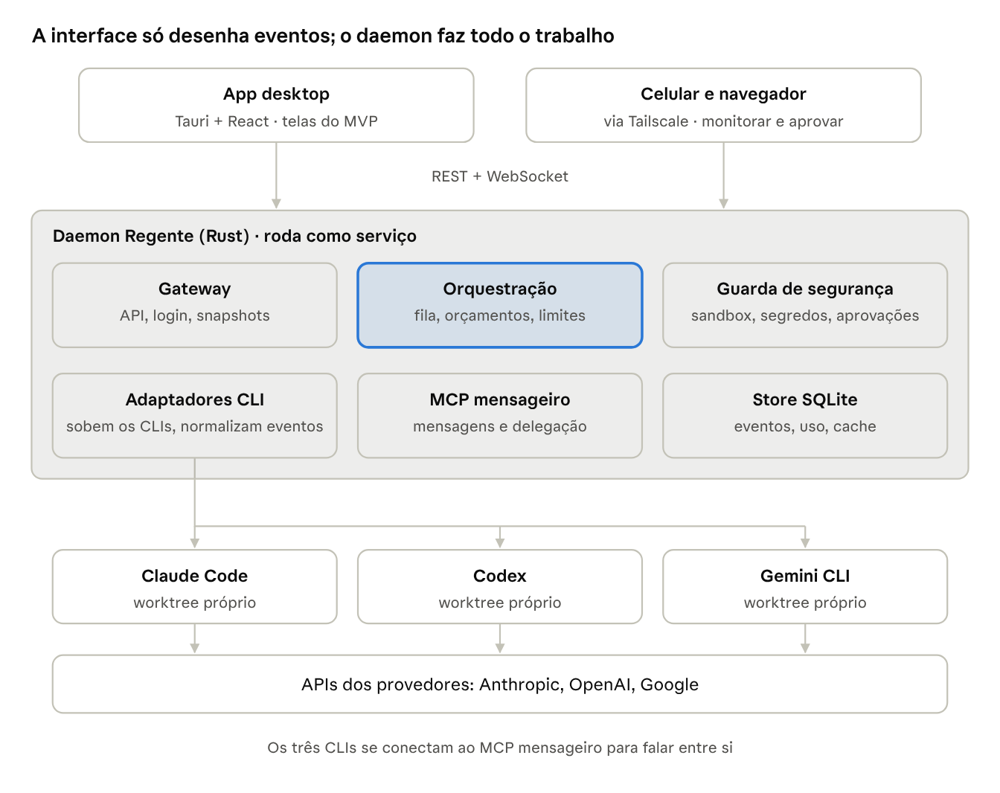
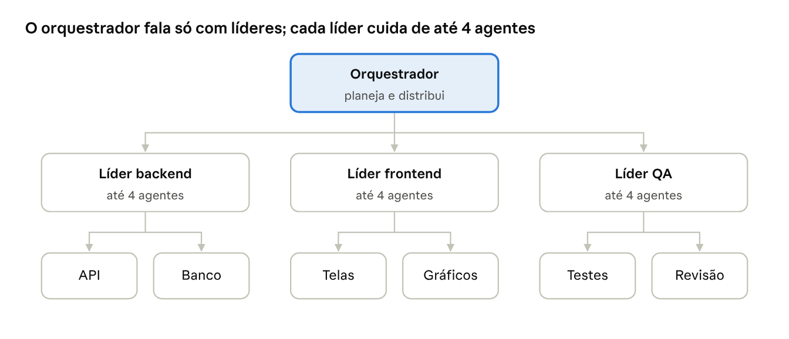

# Regente — System Design

14/11/2026 · Pedro

## Resumo

O Regente vira um **daemon local em Rust** que roda os agentes e guarda tudo, com uma **interface Tauri + React** que só desenha eventos. Trocar de linguagem não resolve sozinho o uso de GPU: ele vem de renderização (canvas, terminais e animações), e é a interface orientada a eventos que corta esse custo.

| # | Gargalo | Status | Como o design resolve |
| --- | --- | --- | --- |
| 1 | GPU e processamento do Maestri | Resolvido no design | UI desenha eventos, não terminais; animações pausam fora da tela; daemon sem interface |
| 2 | Monitoramento dos agentes | Concluído | Telas de visão geral e de agente (canvas do MVP) |
| 3 | Segurança e vazamento de segredos | Resolvido no design | Sandbox por CLI, segredos fora do ambiente dos agentes, varredura de saída, mensagens tratadas como dados |
| 4 | Uso extrapolado de tokens | Resolvido no design | Orçamentos por agente e tarefa, resumos no lugar do histórico, cache de prompt, limite de mensagens |
| 5 | Acesso remoto | Resolvido no design | Daemon exposto só via rede privada (Tailscale), com login e aprovações pelo celular |
| 6 | Estrutura do banco | Resolvido no design | SQLite em modo WAL, eventos só de acréscimo, tabelas de leitura derivadas |
| 7 | Cache | Resolvido no design | Quatro camadas: estado em memória, cache de prompt, mapa do projeto, snapshots da UI |
| 8 | Worktrees | Resolvido no design | Um worktree por agente e tarefa, com ciclo de vida e limpeza automáticos |
| 9 | Versionamento | Resolvido no design | Checkpoints por etapa, branch por tarefa, configuração versionada no repositório |
| 10 | Orquestrador com mais agentes | Resolvido no design | Hierarquia de líderes, fila com limite por provedor, agentes sem processo quando ociosos |

## Arquitetura geral

Todo o trabalho fica num **daemon** que roda como serviço: ele sobe os CLIs, guarda os eventos, aplica limites e segurança. A interface, no desktop ou no celular, é só um cliente que recebe eventos prontos e nunca renderiza terminais por padrão.

Os adaptadores leem a saída estruturada de cada CLI e gravam eventos padronizados no SQLite. A orquestração decide quem roda, quando e com qual orçamento; a guarda de segurança fica no caminho de toda ação.

## Tecnologia e uso de GPU

Decisão: **daemon em Rust + interface Tauri com React/TypeScript**. Rust reduz CPU e memória do núcleo, mas a GPU só cai se a interface parar de redesenhar o tempo todo.

### De onde vem o uso de GPU

- **Terminais renderizados ao vivo**: cada agente com um terminal na tela redesenha a cada linha de saída. Com 4 a 8 agentes, são 4 a 8 superfícies atualizando sem parar.
- **Canvas infinito**: zoom e pan com muitos nós visíveis mantém a GPU ocupada mesmo parado.
- **Animações contínuas**: pets, pulsos e spinners em loop, inclusive fora da tela.
- **Os próprios CLIs**: Claude Code, Codex e Antigravity CLI (agy) têm seu próprio custo de CPU, que existe em qualquer orquestrador.

### Regras de renderização (valem para qualquer linguagem)

1. A interface mostra **eventos estruturados**, não terminais. O terminal só é criado quando você clica em "Abrir terminal" e é destruído ao fechar.
2. Atualizações da UI são **agrupadas a cada 250 ms** (no máximo 4 redesenhos por segundo por agente).
3. Animações só rodam em elementos visíveis (IntersectionObserver) e param quando a janela perde o foco.
4. Pets em pixel art usam sprites CSS com poucos quadros, sem canvas WebGL.
5. Sem efeitos de blur, sombra ou gradiente animado.

### Comparação das opções para o daemon

| Opção | Desempenho | Velocidade de desenvolvimento | Ecossistema para o Regente | Risco |
| --- | --- | --- | --- | --- |
| **Rust (tokio)** | Alto, memória baixa e previsível | Média; curva de aprendizado real | PTY, SQLite, HTTP/WebSocket, SDK oficial de MCP; Tauri já é Rust | Aprender Rust enquanto constrói |
| Go | Alto, um pouco mais de memória (GC) | Alta; linguagem simples | Bom em PTY, HTTP e SQLite; SDK de MCP existe | Duas linguagens se a UI for Tauri |
| Node/TypeScript | Médio; maior uso de memória | Muito alta; você já domina | O melhor para MCP e para os CLIs (mesmo ecossistema) | Consumo maior com muitos agentes |
| C++ | O mais alto | Baixa; muito código de base | Fraco para MCP, HTTP e JSON | Bugs de memória, sem ganho prático aqui |

C++ fica descartado: o daemon passa a maior parte do tempo esperando I/O dos CLIs e da rede, então o ganho de velocidade não aparece e o custo de segurança de memória aparece.

### Por que Rust e não Go

- O Tauri já exige Rust; com o daemon em Rust, o projeto tem só duas linguagens (Rust e TypeScript).
- Um binário único, sem runtime, facilita rodar o daemon como serviço e acessar remotamente.
- Memória previsível importa quando o orquestrador gerencia muitos agentes por horas.

### Por que Tauri e não Electron

O Tauri usa o navegador do sistema em vez de embutir um Chromium inteiro, então o app fica bem menor e consome menos memória. As telas do canvas em React são reaproveitadas sem mudança.

### Plano B

Se a curva do Rust travar o MVP, o daemon pode começar em TypeScript (Node ou Bun) com a mesma API. A troca depois fica contida, porque a interface só conversa com o daemon por WebSocket e REST.

## Segurança

Regra central: **nenhum agente vê um segredo, e nenhum texto que chega de fora vira instrução**. A segurança fica em camadas, porque nenhuma delas sozinha segura um agente com acesso a shell.

### 1. Segredos fora do alcance dos agentes

- Um git worktree só contém arquivos versionados, então o `.env` (que está no .gitignore) **não existe** na pasta do agente. Isso já é a primeira barreira.
- Os processos dos CLIs sobem com um **ambiente limpo**: o daemon remove variáveis com cara de segredo (`*_KEY`, `*_TOKEN`, `*_SECRET`, `DATABASE_URL`) antes de iniciar cada agente.
- Quando um agente precisa rodar algo que usa segredos (testes, migrações), ele chama `regente run -- npm test`. O daemon injeta as variáveis só nesse processo filho e devolve ao agente a saída **já mascarada**.
- Padrões bloqueados por projeto (`.env*`, `secrets/`, `*.pem`, `id_*`) viram regras de negação de leitura em cada CLI.

### 2. Sandbox nativo de cada CLI

| CLI | Mecanismo | Configuração padrão do Regente |
| --- | --- | --- |
| Claude Code | Regras de permissão no settings.json (allow, ask, deny) | Negar leitura dos padrões bloqueados; perguntar antes de comandos destrutivos |
| Codex | Modos de sandbox (somente leitura, escrita no workspace, acesso total) | Escrita só no worktree, rede desligada por padrão |
| Antigravity CLI (agy) | A confirmar na documentação do agy | Restringir ao worktree com o que o agy oferecer; se não houver sandbox, rodar dentro de um contêiner |

Antes de implementar, é preciso conferir as opções exatas de cada CLI na versão instalada.

### 3. Varredura de vazamento

- O daemon guarda um hash de cada valor do `.env` (nunca o valor em texto).
- Um observador de arquivos olha cada escrita nos worktrees e procura esses valores e padrões conhecidos de chave (AWS, OpenAI, Stripe, JWT, chaves privadas).
- Achou: bloqueia o commit, marca o evento como **crítico** na UI e pausa o agente.
- A mesma varredura roda nas mensagens entre agentes e em tudo que sai para o MCP de GitHub.

### 4. Prompt injection

- Conteúdo de arquivos, páginas web, issues e respostas de MCP chega ao agente **marcado como dado não confiável**, com a instrução de nunca executá-lo.
- Mensagens entre agentes também são dados: uma mensagem **nunca aumenta permissões**. Se o Backend pedir "rode isso com acesso total", o daemon recusa, porque permissão só muda pela sua configuração.
- Cada agente tem uma lista fechada de ferramentas e MCPs. Ferramenta fora da lista é recusada no daemon, não no prompt.
- Ações irreversíveis (push, deletar arquivos fora do worktree, migração em banco real, deploy) exigem **sua aprovação**, pelo desktop ou pelo celular.

### 5. Rede e auditoria

- Saída de rede dos agentes desligada por padrão; quando ligada, só para domínios liberados (registros de pacotes, GitHub, documentação).
- Log de auditoria só de acréscimo: quem pediu o quê, qual comando rodou, qual arquivo mudou, qual aprovação foi dada.

## Controle de tokens

O gasto explode por três motivos: histórico que cresce a cada retomada, agentes relendo os mesmos arquivos e conversas entre agentes sem fim. O daemon ataca os três e impõe um teto rígido.

### Tetos (o daemon corta, não o prompt)

- Orçamento por **tarefa**, por **agente** e por **dia**, em dólar e em % da janela de 5h e da semana de cada plano.
- Ao chegar em 80%: aviso na UI. Em 100%: o agente pausa e a tarefa volta para o orquestrador ou para você.
- Limite de mensagens por tarefa (padrão 20) e de rodadas sem progresso (3 rodadas sem arquivo alterado ou teste novo = pausa).

### Menos contexto por chamada

1. **Resumo no lugar do histórico**: ao delegar, o orquestrador manda um briefing curto (objetivo, arquivos relevantes, critério de pronto), não a conversa inteira.
2. **Handoff por diff**: quando um agente passa trabalho para outro, vai o diff e um resumo de 5 linhas, não a sessão.
3. **Sessões curtas**: uma sessão nova por tarefa; a memória de longo prazo fica nos arquivos de contexto do projeto, não na conversa.
4. **Compactação**: passou de um limite de contexto, o daemon pede ao próprio CLI para compactar ou reinicia a sessão com um resumo.

### Menos leitura repetida

- **Mapa do projeto** em cache (ver seção Cache): estrutura de pastas e resumo de cada arquivo, entregue ao agente em vez de ele abrir dez arquivos para se situar.
- Prefixo estável nos prompts (instruções do agente + contexto do projeto) para aproveitar o cache de prompt dos provedores, que cobra menos pelos tokens repetidos.

### Modelo certo para cada trabalho

- Resumos, títulos de evento e o texto de "Fazendo agora" usam o modelo mais barato disponível.
- O orquestrador decide o esforço de raciocínio por tarefa: alto só para planejamento e revisão.
- Quando um plano está perto do limite, tarefas simples migram para outro provedor (configurável em Contas e perfis).

## Acesso remoto

O daemon roda na sua máquina e serve a mesma interface pelo navegador. Ele **nunca abre porta na internet**: o acesso de fora passa por uma rede privada (Tailscale ou WireGuard).

- **Separação daemon e UI**: o app Tauri no desktop e o navegador do celular são dois clientes do mesmo daemon (REST + WebSocket). Fechar o app não para os agentes.
- **Login**: token de dispositivo gerado no desktop e pareado por QR code; cada dispositivo pode ser revogado em Contas e perfis.
- **Papéis por dispositivo**: o celular entra como "monitorar e aprovar" por padrão. Editar permissões, pastas e segredos só no desktop.
- **Aprovações pelo celular**: ações que pedem aprovação geram notificação push (PWA); você aprova ou nega dali.
- **Banda**: o celular recebe só eventos resumidos e o estado atual; o terminal completo só é transmitido se você abrir.
- **Desligamento seguro**: se a conexão cair, os agentes continuam; ações que esperam aprovação ficam pausadas, nunca aprovadas por tempo esgotado.

## Banco de dados

SQLite local em modo WAL, com uma tabela de **eventos só de acréscimo** como fonte da verdade. As outras tabelas de estado são derivadas dela e podem ser reconstruídas.

| Tabela | Guarda | Colunas principais |
| --- | --- | --- |
| `projects` | Projetos e regras | id, nome, contexto, pastas (JSON), bloqueados (JSON), orçamento_dia |
| `agents` | Definição de cada agente | id, project_id, nome, cli, papel, is_orchestrator, parent_id, pet (JSON), permissões (JSON) |
| `accounts` | Contas dos provedores | id, provedor, tipo_login, caminho_cli, modelo_padrão, regra_limite |
| `tasks` | Tarefas e etapas | id, project_id, parent_task_id, owner_agent_id, status, branch, orçamento, criada_em |
| `sessions` | Sessões de cada CLI | id, agent_id, task_id, cli_session_id, worktree, iniciada_em, encerrada_em |
| `events` | Tudo que acontece (só acréscimo) | id, ts, agent_id, task_id, tipo, alvo, resumo, payload (JSON) |
| `messages` | Mensagens entre agentes | id, task_id, de, para, texto, entregue_em |
| `usage` | Tokens e custo por chamada | id, ts, agent_id, account_id, tokens_in, tokens_out, tokens_cache, custo_usd |
| `file_changes` | Arquivos alterados | id, event_id, caminho, linhas_mais, linhas_menos, diff_ref |
| `approvals` | Pedidos de aprovação | id, agent_id, ação, status, decidido_por, decidido_em |
| `plugins` / `skills` | MCPs e skills instalados | id, nome, origem, config (JSON), clis, escopo |
| `usage_windows` | Uso agregado por janela | account_id, janela (5h, dia, semana), início, tokens, custo, pct |

- **Diffs grandes** ficam em arquivos no disco (`.regente/diffs/`), e o banco guarda só a referência.
- **Retenção**: eventos detalhados por 30 dias; depois viram um resumo por tarefa. Uso e auditoria ficam para sempre (são pequenos).
- **Índices**: `events(agent_id, ts)`, `events(task_id, ts)`, `usage(account_id, ts)`.
- **Migrações** numeradas e versionadas junto com o código do daemon.

## Cache

Quatro camadas, cada uma com um dono e uma regra de invalidação clara.

| Camada | Onde vive | O que guarda | Invalida quando |
| --- | --- | --- | --- |
| Estado ao vivo | Memória do daemon | Status, "Fazendo agora" e últimas 20 alterações de cada agente | Chega um evento novo do agente |
| Cache de prompt | No provedor | Prefixo estável: instruções do agente + contexto do projeto | O contexto do projeto ou as instruções mudam |
| Mapa do projeto | SQLite + arquivos em `.regente/cache/` | Árvore de pastas, resumo e símbolos de cada arquivo, por hash do conteúdo, grafo do sistema | O hash do arquivo muda (só aquele arquivo é refeito) |
| Snapshots da UI | Memória do daemon | Estado completo de cada tela, para quem conecta agora | A cada 5 s; entre snapshots, só eventos novos |

- Um cliente que abre a UI (ou o celular que reconecta) recebe o snapshot e depois só os eventos novos, sem reler o banco inteiro.
- O mapa do projeto é compartilhado entre todos os agentes do projeto: o primeiro que precisa paga a leitura, os outros reaproveitam.
- Nada de segredo entra em cache: a varredura de segredos roda antes de qualquer escrita em `.regente/cache/`.

## Worktrees

Cada agente trabalha num worktree próprio **por tarefa**, criado e removido pelo daemon. Assim dois agentes nunca editam o mesmo arquivo ao mesmo tempo, e cada tarefa tem uma branch limpa para revisar.

### Ciclo de vida

1. **Criar**: `git worktree add .regente/wt/<agente>-<tarefa> -b regente/<tarefa>/<agente>` a partir da branch base do projeto.
2. **Preparar**: dependências instaladas a partir de um cache compartilhado (store do pnpm ou cache do cargo), para não baixar tudo a cada worktree.
3. **Trabalhar**: o CLI roda com o worktree como pasta de trabalho e o sandbox limitado a ela.
4. **Checkpoint**: a cada etapa concluída, o daemon faz um commit automático na branch do agente (ver Versionamento).
5. **Revisar**: o QA ou o orquestrador revisa o diff da branch. Reprovado, volta ao passo 3 com o motivo.
6. **Integrar**: aprovado, merge na branch da tarefa; conflitos voltam para o agente dono do arquivo.
7. **Limpar**: `git worktree remove` e exclusão da branch do agente após o merge; worktrees parados há mais de 7 dias são listados para você decidir.

### Problemas práticos resolvidos

- **Portas**: cada worktree recebe uma faixa de portas (ex.: 4100–4109 para o primeiro agente) via variável de ambiente, para dois servidores de dev não brigarem.
- **Arquivos ignorados**: como `.env` não vem para o worktree, o daemon gera um `.env.regente` com valores falsos ou injeta os reais só via `regente run`.
- **Conflito antecipado**: se dois agentes alteram o mesmo arquivo em tarefas paralelas, o orquestrador é avisado na hora, não só no merge.
- **Disco**: limite de worktrees ativos por projeto (padrão 8) e aviso quando a pasta `.regente/wt` passa de um tamanho configurado.

## Versionamento

Quatro coisas são versionadas, cada uma do seu jeito.

| O quê | Como | Para quê |
| --- | --- | --- |
| Código feito pelos agentes | Branch por tarefa (`regente/<tarefa>`) e por agente; commit automático a cada etapa com o autor `Regente/<agente>` e o id da tarefa na mensagem | Desfazer uma etapa ruim sem perder o resto; saber qual agente escreveu cada linha |
| Configuração do time | Agentes, papel, permissões e plugins do projeto em `.regente/team.yaml`, dentro do repositório | Revisar mudanças de permissão em PR; recriar o time em outra máquina |
| Banco do daemon | Migrações numeradas, aplicadas na inicialização, com backup automático do arquivo antes | Atualizar o app sem perder histórico |
| O próprio Regente | Versionamento semântico; contrato da API entre daemon e UI com versão própria | UI antiga avisa quando o daemon é mais novo, e vice-versa |

- Os checkpoints são **squashados** no merge da tarefa, para o histórico principal ficar legível.
- Segredos e caminhos absolutos nunca entram em `team.yaml`: só nomes de variáveis e caminhos relativos.

## Orquestrador com mais agentes

O limite real não é o número de processos, é o contexto do orquestrador: cada agente a mais é mais coisa para ele acompanhar. A solução é hierarquia, com o daemon (e não o modelo) controlando a fila.

Os nomes dos agentes no desenho são exemplos. Com 3 líderes de até 4 agentes cada, o orquestrador acompanha 3 conversas em vez de 12.

- **Líderes**: agentes com `is_orchestrator` e um `parent_id`. Recebem uma parte da tarefa, delegam e devolvem só um resumo para cima.
- **Fila no daemon**: tarefas entram numa fila com prioridade e dependências (a etapa de testes só começa quando a API termina). O daemon decide quando cada agente roda, não o modelo.
- **Limite por provedor**: máximo de agentes simultâneos por conta (ex.: 3 no Claude, 2 no Codex, 2 no Antigravity), para não estourar a janela de 5h nem os limites de taxa.
- **Agente ocioso não ocupa processo**: o CLI sobe para cada turno e encerra; a sessão é retomada pelo id guardado no banco. Vinte agentes cadastrados podem ter só quatro processos vivos.
- **Contexto do orquestrador sempre curto**: ele vê o estado das tarefas e os resumos dos líderes, nunca as conversas inteiras.
- **Back-pressure**: se a fila crescer ou o orçamento do dia passar de 80%, o orquestrador para de abrir tarefas novas e avisa você.

## Fases, riscos e pontos a validar

### Ordem de construção

1. **Núcleo do daemon**: processo em Rust, SQLite com eventos, API REST + WebSocket.
2. **Adaptadores dos 3 CLIs**: rodar Claude Code, Codex e Antigravity CLI (agy) em modo headless e normalizar os eventos.
3. **Segurança base**: ambiente limpo, regras de negação por CLI, worktree por agente, varredura de segredos.
4. **MCP mensageiro**: mensagens e delegação entre agentes, com limite de mensagens.
5. **Interface**: visão geral e tela do agente em Tauri, consumindo só eventos.
6. **Tokens e contas**: orçamentos, janelas de uso, pausa automática.
7. **Criar agente e projeto, plugins e skills**.
8. **Acesso remoto e aprovações pelo celular**.
9. **Escala**: líderes de equipe e fila com limite por provedor.

### Riscos

| Risco | Impacto | Mitigação |
| --- | --- | --- |
| Curva de aprendizado do Rust atrasa o MVP | Alto | Plano B: daemon em TypeScript com a mesma API; trocar depois |
| Formato de saída dos CLIs muda numa atualização | Alto | Um adaptador isolado por CLI, testes com saída gravada, versão mínima suportada |
| Agente contorna o sandbox via shell | Alto | Segredos fora do worktree e do ambiente; varredura de saída; aprovação para ações irreversíveis |
| Uso de 5h e semanal não exposto pelos CLIs | Médio | Estimar pelo próprio registro de tokens e mostrar como estimativa |
| Muitos worktrees enchem o disco | Médio | Limite por projeto e limpeza após merge |

### Pontos a validar antes de implementar

- [ ] Flags de saída estruturada e de retomada de sessão de cada CLI na versão instalada
- [ ] Opções exatas de sandbox e de regras de permissão de cada CLI
- [ ] Se cada CLI informa a % de uso do plano de forma legível por programa
- [ ] Medir o consumo atual do Maestri (CPU, GPU, memória) com 4 agentes, para comparar com o Regente
- [ ] APIs públicas das lojas de skills de cada provedor
